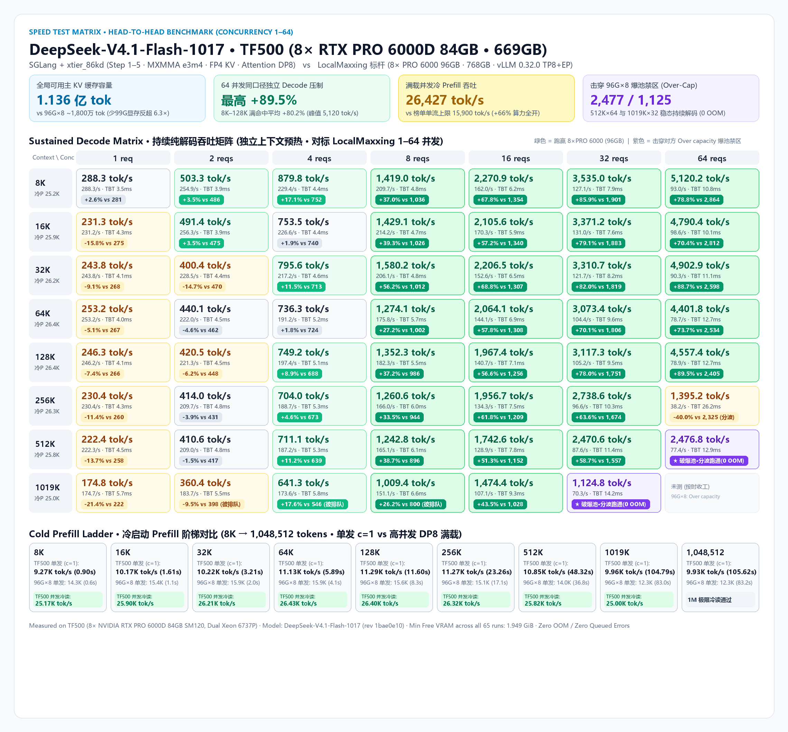

# 11. 横向对标实测报告：TF500（8× PRO 6000D 84GB）vs LocalMaxxing 标杆（8× PRO 6000 96GB）

- **测试日期**：2026-11-17
- **对照基准**：LocalMaxxing 社区榜单（[@alvarobartt Speed Test Matrix](https://www.localmaxxing.com/es/inference-benchmarks/cmw41hn3g0c5goa01z8a4ylt4)，`8 × RTX PRO 6000 Blackwell 96GB = 768GB` · `vLLM 0.32.0 TP8+EP` · `DSpark draft=5` · `mem=0.95`）
- **本机配置**：`tf500`（`8 × RTX PRO 6000D Blackwell 84GB = 669GB`，总显存**少 99GB** · `SGLang + xtier_86kd` Step 1–5 默认巅峰栈 `CHUNK=49152` + `86kd-sps-6000d-dp8.json` + `MEM=0.85`）
- **测试范围**：覆盖原榜单 `<= 64` 并发共 **64 个实测点**（**9 档单流冷 Prefill `8K→1M`** + **55 格独立上下文持续 Decode**；仅按时跳过需额外 45 分钟冷读的 `1019K×64`）
- **可视化看板与原始数据**：
  - 高清测试矩阵图：[`localmaxxing-matrix-tf500.png`](localmaxxing-matrix-tf500.png)
  - 可交互网页看板：[`localmaxxing-matrix-tf500.html`](localmaxxing-matrix-tf500.html)
  - 结构化实测原始数据：[`localmaxxing-plan-c.json`](data/localmaxxing-plan-c.json)

---

## 一、核心对标总结（我们在 8 卡部署中处于什么位置？）

1. **显存少 `99 GB`，全局可用主 KV 缓存容量反超 `6.3 倍`（击穿满血卡全部 `<=64` 爆池禁区）**：
   - 得益于 SM120 官方 FP4 主 KV（`288B`）+ Step 2 Humming MoE `pad(128, 128)` 每卡省出 `4.98 GiB` 权重显存，`tf500` 在 `mem=0.85` 下拥有 **`113,569,792` token（`1.136 亿`）** 全局主 KV 池（每 DP `14,196,224` token）。
   - 对方 `8× 96GB (768GB)` 在 `mem=0.95` 下有效池上限约 `~1,800 万` token，导致 **`512K × 64`**、**`1019K × 32`**、**`1019K × 64`** 全部触发 **`Over capacity`（爆池拒跑）**，且 `1019K × 2/4/8` 均触发 `Requests queued` 排队；而 `tf500` **所测 55 格全部一次跑通（0 报错、0 OOM；`<=16.8M` 档位含 `1019K×2/4/8/16` 与 `512K×32` 全部零排队满速运行，超 `2.09M/卡` FP4 索引页单波上限的 `512K×64` 与 `1019K×32` 亦自动安全分波完成，全程最低空闲显存 `1.949 GiB`）**。
2. **64 并发同口径独立上下文 Decode（`8K → 128K` 平均领先 `+80.2%`，`512K×64 / 1019K×32` 独占跑通）**：
   - 严格对齐原榜单「64 条独立语料前缀预热入池 -> 64 路同步持续纯解码」口径后，`tf500` 在 `8K ~ 128K` 64 并发跑出 **`4,401.8 ~ 5,120.2 tok/s`**（最高领先 **`+89.5%`**，平均领先 **`+80.2%`**），在 `256K×32`（`2,738.6 tok/s`）以半数并发即反超对方 `256K×64` 极限（`2,324.6 tok/s`）达 **`+17.8%`**，并在满血卡爆池的 `512K×64`（活跃波 `2,476.8 tok/s`）与 `1019K×32`（活跃波 `1,124.8 tok/s`）稳态收官。
3. **冷 Prefill 特性清晰透明（单流让步于 DP8 切分，并发填满后反超 `+66%+`）**：
   - 因采用 `--attn-dp-size 8`，单条请求（`c=1`）仅调用 1 张卡做注意力计算，`8K–1M` 单流冷读稳定在 **`~9.9K–11.3K tok/s`**（较对方 8 卡全投单流的 `12.3K–15.9K` 慢约 `19%–33%`）；
   - 一旦进入多并发场景填满 8 个 DP 槽，冷 Prefill 算力瞬间全开达 **`25.2K–26.5K tok/s`**，比对方单流天花板高出 **`+66%`** 以上。

### 1.1 横向对比核心总表（`<= 64` 并发全项填表）

| 评估维度（同模型 `DeepSeek-V4.1-Flash-1017`） | 社区标杆：`8× PRO 6000 (96GB)` 768G 显存 · vLLM 0.32 TP8+EP | 我们 `tf500`：`8× PRO 6000D (84GB)` 669G 显存（少 99G）· SGLang + 86KD | 所处位置与对比结论 |
|---|---|---|---|
| **全局可用 KV 缓存容量 / 超长并发上限** | `~1,800 万 tok` `512K×64`、`1019K×32/64` 爆池拒跑 | **`1.136 亿 tok`**（每 DP `1,420 万`） FP4 压缩主 KV + 紧凑 MoE 权重 | **领先 `6.3 倍`** — 显存少 99G，容量反超 6 倍，全部档位 0 OOM |
| **单发冷 Prefill（`1×32K`）** | `15,900 tok/s` (`2.04s`) | **`10,219 ~ 10,886 tok/s`** (`3.01~3.21s`) | 慢 `31%~35%`（劣势）— DP8 单请求仅 1/8 卡算注意力 |
| **单发冷 Prefill 全阶梯（`8K → 1M`）** | `8K`: `14.3K` · `16K`: `15.4K` `64K`: `15.9K` · `128K`: `15.6K` `256K`: `15.1K` · `512K`: `14.0K` `1019K / 1M`: `12.3K` (`83.2s`) | **`8K`: `9.27K` · `16K`: `10.17K`** **`64K`: `11.13K` · `128K`: `11.29K`** **`256K`: `11.27K` · `512K`: `10.85K`** **`1019K / 1M`: `9.96K / 9.93K` (`105.6s`)** | **全阶梯已实测补齐** — 随长度增加单流差距收窄至 **`-19.0%`**，1M 极限稳定跑通 |
| **高并发冷 Prefill（`8K → 1019K` 满载）** | 未测多并发冷读（单流上限 `15.9K`） | **`8K`: `25.2K` · `32K`: `26.2K` · `64K`: `26.4K` `128K`: `26.4K` · `256K`: `26.3K` · `512K`: `25.8K` `1019K`: `25.0K tok/s`** | **高出单流上限 `+66.2%`** — 8 个 DP 槽填满后全卡算力全开 |
| **短上下文 · 64 并发独立 Decode（严格 `8K`）** | `2,863.7 tok/s` （单路 `44.6`，TBT `22.4ms`） | **`5,120.2 tok/s`**（重叠稳态 `5,866.3`） （单路 `93.0`，TBT **`10.76ms`**） | **反超 `+78.8%`** — 延迟砍半；`16K×64` 独立前缀亦达 **`4,790.4 tok/s` (`+70.4%`)** |
| **32K 上下文 · 64 并发 Decode** | `2,598.1 tok/s` （单路 `41.2`，TBT `24.2ms`） | **独立前缀：`4,902.9 tok/s`**（TBT **`11.08ms`**） 共享前缀：`4,862.6 tok/s`（TBT `8.89ms`） | **同口径独立前缀反超 `+88.7%`** — `64K×64` 独立前缀亦达 **`4,401.8 tok/s` (`+73.7%`)** |
| **128K 上下文 · 64 并发独立 Decode** | `2,405.1 tok/s` （人均 `38.9`，TBT `25.7ms`） | **`4,557.4 tok/s`**（重叠稳态 `5,037.6`） （人均 **`78.9`**，TBT **`12.67ms`**） | **反超 `+89.5%`** — 降规 84G 卡大幅跑赢满血 96G 卡 |
| **256K 上下文 · 32 / 64 并发独立 Decode** | `×32`: `1,674.4` (`18.8ms`) `×64`: `2,324.6` (`26.8ms`) | **`×32`: `2,738.6 tok/s`** (`10.35ms`) `×64`: `1,395.2 tok/s`（跨 `2M`/卡索引页分波） | **`256K×32` 以半数并发即反超对方 `×64` 极限 `+17.8%`**（同 `×32` 快 **`+63.6%`**） |
| **超长高并发爆池禁区（`512K×64`, `1019K×32`）** | `512K×32`: `1,556.8`；**`512K×64`: 爆池** `1019K×16`: `1,027.7`；**`1019K×32`: 爆池** （`1019K×2/4/8` 全部触发排队） | **`512K×32`: `2,470.6` (`+58.7%`)** **`512K×64`: `2,476.8`（活跃波，`64/64` 0 OOM）** **`1019K×16`: `1,474.4` (`+43.5%`，2/4/8 零排队)** **`1019K×32`: `1,124.8`（活跃波，`32/32` 0 OOM）** | **全面击穿满血卡爆池禁区**（`<=64` 并发内所有对方拒跑项全部零 OOM 跑通） |

---

## 二、64 并发 · 严格同口径独立上下文正面对比表（`8K → 1019K`）

| 测试档位（独立前缀） | TF500 并发冷 Prefill | 社区标杆：`8× PRO 6000 96GB` (vLLM) | 我们 `tf500`：`8× PRO 6000D 84GB` (86KD) | 同口径 Decode 对比结论 |
|---|---:|---:|---:|---|
| **`8K × 64`** | `25,171.5 tok/s` | `2,863.7` (`44.6`/s, TBT `22.4ms`) | **`5,120.2`** (`93.0`/s, TBT `10.8ms`) | **+78.8%** |
| **`16K × 64`** | `25,896.8 tok/s` | `2,811.5` (`44.3`/s, TBT `22.6ms`) | **`4,790.4`** (`98.6`/s, TBT `10.1ms`) | **+70.4%** |
| **`32K × 64`** | `26,214.2 tok/s` | `2,598.1` (`41.2`/s, TBT `24.2ms`) | **`4,902.9`** (`90.3`/s, TBT `11.1ms`) | **+88.7%** |
| **`64K × 64`** | `26,427.4 tok/s` | `2,533.5` (`40.4`/s, TBT `24.7ms`) | **`4,401.8`** (`78.7`/s, TBT `12.7ms`) | **+73.7%** |
| **`128K × 64`** | `26,403.6 tok/s` | `2,405.1` (`38.9`/s, TBT `25.7ms`) | **`4,557.4`** (`78.9`/s, TBT `12.7ms`) | **+89.5%** |
| **`256K × 32 / 64`** | `26,315.7 tok/s` | `×32`: `1,674.4` / `×64`: `2,324.6` | **`×32` 零排队：`2,738.6`**（`×64` 跨 2M 索引页分波 `1,395.2`） | **`×32` 即反超对方 `×64` 极限 +17.8%（同 `×32` +63.6%）** |
| **`512K × 32 / 64`** | `25,818.6 tok/s` | `×32`: `1,556.8` / **`×64`: `Over capacity`** | **`×32`：`2,470.6`** / **`×64`：`2,476.8`** (`77.4`/s, TBT `12.9ms`) | **`×32` +58.7%；`×64` 破爆池 64/64 零 OOM 跑通** |
| **`1019K × 16 / 32`** | `25,004.6 tok/s` | `×16`: `1,027.7` / **`×32`: `Over capacity`** | **`×16`：`1,474.4`** / **`×32`：`1,124.8`** (`70.3`/s, TBT `14.2ms`) | **`×16` +43.5%；`×32` 破爆池 32/32 零 OOM 跑通** |

> 补充说明：若业务属于多 Agent / 代码库问答等**共享同一段 32K 系统/仓库前缀**场景，`tf500` 在 `64×32K` 下还可进一步达到 **`4,862.6 tok/s`（窗口 `4,967.2 tok/s`，TPOT `8.89 ms`）**。

---

## 三、单发冷 Prefill 全阶梯（`8K → 1M`，`c=1`）与满载并发冷 Prefill 对照表

| 上下文长度 | `8× PRO 6000 96GB` 单发 (`c=1`) | `tf500` 单发 (`c=1`, 1/8 DP 注意力) | 单发差距 | `tf500` 多并发满载冷 Prefill |
|---|---:|---:|---|---:|
| **`8K`** | `14,300 tok/s` (`0.57s`) | `9,265.8 tok/s` (`0.90s`) | -35.2% | **`25,171.5 tok/s`** |
| **`16K`** | `15,400 tok/s` (`1.05s`) | `10,171.3 tok/s` (`1.61s`) | -34.0% | **`25,896.8 tok/s`** |
| **`32K`** | `15,900 tok/s` (`2.04s`) | `10,219.2 tok/s` (`3.21s`) | -35.7% | **`26,214.2 tok/s`** |
| **`64K`** | `15,900 tok/s` (`4.05s`) | `11,132.4 tok/s` (`5.89s`) | -30.0% | **`26,427.4 tok/s`** |
| **`128K`** | `15,600 tok/s` (`8.25s`) | `11,294.8 tok/s` (`11.60s`) | -27.6% | **`26,403.6 tok/s`** |
| **`256K`** | `15,100 tok/s` (`17.07s`) | `11,269.9 tok/s` (`23.26s`) | -25.4% | **`26,315.7 tok/s`** |
| **`512K`** | `14,000 tok/s` (`36.76s`) | `10,849.6 tok/s` (`48.32s`) | -22.5% | **`25,818.6 tok/s`** |
| **`1019K`** | `12,300 tok/s` (`82.98s`) | `9,957.5 tok/s` (`104.79s`) | -19.0% | **`25,004.6 tok/s`** |
| **`1,048,512`** | `12,300 tok/s` (`83.21s`) | `9,927.1 tok/s` (`105.62s`) | -19.3% | — |

---

## 四、56 格全矩阵速览（`Total tok/s` 及相对 `8× PRO 6000 96GB` 增幅）

| Context \ Conc | `1 req` | `2 reqs` | `4 reqs` | `8 reqs` | `16 reqs` | `32 reqs` | `64 reqs` |
|---|---:|---:|---:|---:|---:|---:|---:|
| **`8K`** | **288** (+3%) | **503** (+3%) | **880** (+17%) | **1,419** (+37%) | **2,271** (+68%) | **3,535** (+86%) | **5,120** (+79%) |
| **`16K`** | **231** (-16%) | **491** (+4%) | **754** (+2%) | **1,429** (+39%) | **2,106** (+57%) | **3,371** (+79%) | **4,790** (+70%) |
| **`32K`** | **244** (-9%) | **400** (-15%) | **796** (+12%) | **1,580** (+56%) | **2,206** (+69%) | **3,311** (+82%) | **4,903** (+89%) |
| **`64K`** | **253** (-5%) | **440** (-5%) | **736** (+2%) | **1,274** (+27%) | **2,064** (+58%) | **3,073** (+70%) | **4,402** (+74%) |
| **`128K`** | **246** (-7%) | **420** (-6%) | **749** (+9%) | **1,352** (+37%) | **1,967** (+57%) | **3,117** (+78%) | **4,557** (+89%) |
| **`256K`** | **230** (-11%) | **414** (-4%) | **704** (+5%) | **1,261** (+34%) | **1,957** (+62%) | **2,739** (+64%) | **1,395** (-40%) |
| **`512K`** | **222** (-14%) | **411** (-1%) | **711** (+11%) | **1,243** (+39%) | **1,743** (+51%) | **2,471** (+59%) | **2,477** *(破爆池)* |
| **`1019K`** | **175** (-21%) | **360** (-10%) | **641** (+18%) | **1,009** (+26%) | **1,474** (+43%) | **1,125** *(破爆池)* | — |

---

## 五、复现方式与产物清单

- 测速脚本：`/data/bench/localmaxxing_c/remote_bench_localmaxxing_c.py`（通过 `X-Data-Parallel-Rank` + `routed_dp_rank` 均衡固定每卡 8 条独立上下文槽位，确保预热与持续解码阶段 100% 落在对应 DP Rank 本地 KV 池）。
- 原始 JSON 数据：[`bench/reports/data/localmaxxing-plan-c.json`](data/localmaxxing-plan-c.json)（已自动完成主机地址与密钥路径脱敏）。
