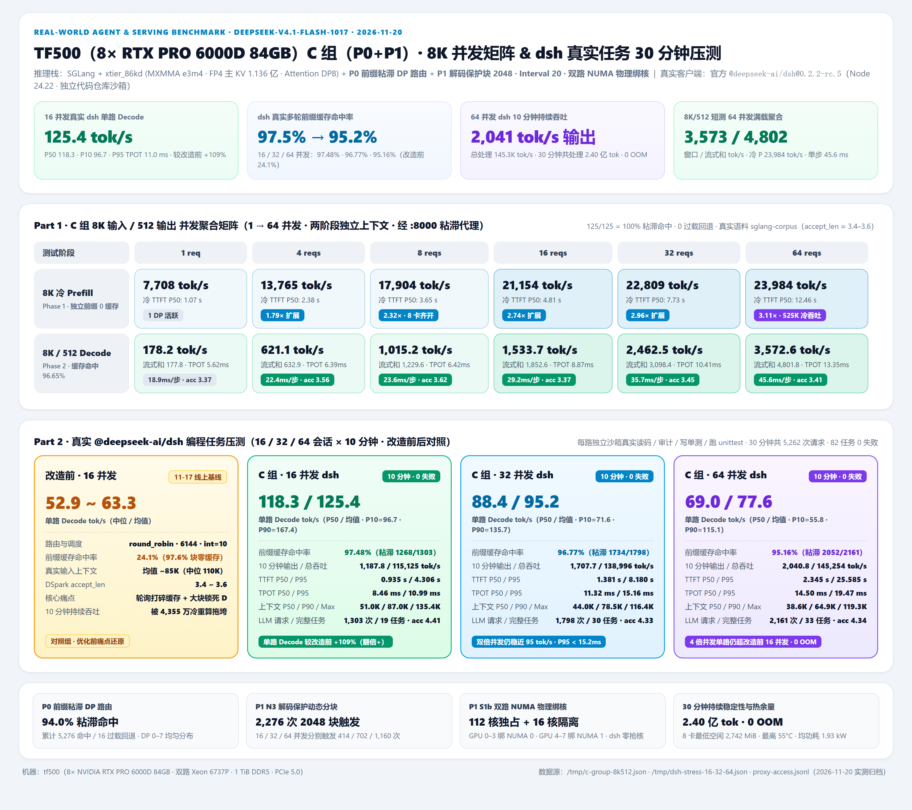

# 12. P0 + P1 真实 Agent 提速实测报告：前缀粘滞 DP 路由、解码保护动态分块与双路 NUMA 绑核

- **日期**：2026-11-20
- **平台**：`tf500`（8× NVIDIA RTX PRO 6000D 84GB，双路 Xeon 6737P，1 TiB DDR5，Attention DP8 + TP8 + DSpark）
- **交互看板与高清图**：[`tf500-c-group-dsh-matrix.html`](tf500-c-group-dsh-matrix.html) · [`tf500-c-group-dsh-matrix.png`](tf500-c-group-dsh-matrix.png)

## 一、改动要点（零侵入 `/data/src/sglang-align`，全部支持独立开关一键回退）

1. **P0-N1 前缀粘滞 DP 路由（`deploy/tf500_dp_router.py` + `deploy/tf500_api_proxy.py`）**：
   - 解决 Attention DP8 下默认 `round_robin` 把多轮长上下文打散导致前缀缓存命中率暴跌至 `24.1%` 的根因；
   - 以 `tools` 为种子对 `messages` 累计规范化哈希（跳过纯 `system`/`developer` 防止共享系统提示热点），双头下发 `X-Data-Parallel-Rank` + `x-override-routed-dp-rank`，带在途过载回退（`TF500_PROXY_STICKY_DP=1`，默认 `max_inflight=8`）。
2. **P0-N2 代理可观测性与多轮 Agent 回放基准（`deploy/tf500_api_proxy.py` + `bench/agent_replay.py`）**：
   - `proxy-access.jsonl` 补齐 `cached_tokens`、`dp_rank`、`dp_route`、`temperature`、`stream`、`ttft_s`、`decode_tps`（仅元数据，绝不落盘正文和密钥）；
   - 新增 `bench/agent_replay.py` 支持多轮并发回放与 `--analyze-log` 真实日志聚合统计。
3. **P1-N3 Decode 保护动态分块 + 干扰调度（`deploy/prefill-opt/prefill_opt_hook.py`）**：
   - 复用 `MLPSyncBatchInfo.all_gather` 全局每步状态（零额外通信），8 卡任意 rank 在 Decode 时将 Prefill 分块动态压低至 `XTIER_DECODE_PROTECT_CHUNK=2048`，全机无 Decode 时保持 `6144` / 单流 `16384` 全速冷启动；搭配 `interval=20`。
4. **P1-S1b 双路 NUMA 物理绑核（`deploy/prefill-opt/prefill_opt_hook.py` + `deploy/tf500_console.py`）**：
   - `XTIER_NUMA_PIN=1` 将 GPU 0–3 进程分片绑至 NUMA 0（预留 `28-31,92-95` 给 HTTP/代理/OS），GPU 4–7 绑至 NUMA 1（预留 `60-63,124-127`）。

## 二、16 并发 × 4 轮多轮 Agent 回放 A/B/C 三组对照（40K 初始 + 每轮 4K 工具输出）

| 指标 | A 组：原版 `round_robin` | B 组：+ P0 粘滞路由 | C 组：+ P0 + P1 (`protect=2048, int=20, NUMA`) |
|---|---:|---:|---:|
| 热轮缓存命中率 (Turn ≥ 1) | `18.59%` | `90.66%` | **`91.23%`** |
| 单路 Decode P10 / P50 / 均值 | `15.3 / 29.8 / 32.2` | `32.6 / 62.5 / 78.5` | **`64.4 / 88.6 / 98.9 tok/s`**（热轮 **`107.0`**） |
| TPOT P50 / P95 | `33.51 / 67.69 ms` | `16.01 / 38.59 ms` | **`11.29 / 17.16 ms`** |
| 64 请求总耗时 | `167.14 s` | `71.54 s` | **`83.28 s`** |

## 三、C 组 `8K 输入 / 512 输出` 并发阶梯（`1 → 64`，经 `:8000` 粘滞代理，100% 粘滞命中）

| 并发 | 冷 Prefill 聚合 (`tok/s`) | 窗口 Decode 聚合 (`tok/s`) | 流式和 Decode (`tok/s`) | TPOT P50 / P95 | 单步耗时 / `accept_len` |
|---:|---:|---:|---:|---:|---|
| `1` | `7,707.6` | `178.2` | `177.8` | `5.62 / 5.62 ms` | `18.90 ms` / `3.37` |
| `4` | `13,764.7` | `621.1` | `632.9` | `6.39 / 6.45 ms` | `22.44 ms` / `3.56` |
| `8` | `17,903.6` | `1,015.2` | `1,229.6` | `6.42 / 7.36 ms` | `23.59 ms` / `3.62` |
| `16` | `21,153.7` | `1,533.7` | `1,852.6` | `8.87 / 9.22 ms` | `29.19 ms` / `3.37` |
| `32` | `22,809.2` | `2,462.5` | `3,098.4` | `10.41 / 11.16 ms` | `35.69 ms` / `3.45` |
| `64` | **`23,983.5`** | **`3,572.6`** | **`4,801.8`** | **`13.35 / 14.85 ms`** | **`45.61 ms`** / `3.41` |

## 四、真实 `@deepseek-ai/dsh@0.2.2-rc.5` 编程任务压测（`16 / 32 / 64` 会话 × 各 10 分钟）

| 指标 | 改造前 16 并发基线 | C 组 · 16 并发 `dsh` | C 组 · 32 并发 `dsh` | C 组 · 64 并发 `dsh` |
|---|---:|---:|---:|---:|
| 前缀缓存命中率 | `24.1%` | **`97.48%`** | **`96.77%`** | **`95.16%`** |
| 单路 Decode P50 / 均值 | `52.9 / 63.3` | **`118.26 / 125.35`** | **`88.36 / 95.20`** | **`68.97 / 77.64`** |
| 单路 Decode P10 / P90 | — | `96.74 / 167.43` | `71.55 / 135.72` | `55.84 / 115.10` |
| TPOT P50 / P95 | — | **`8.46 / 10.99 ms`** | **`11.32 / 15.16 ms`** | **`14.50 / 19.47 ms`** |
| TTFT P50 / P95 | — | `0.935 / 4.306 s` | `1.381 / 8.180 s` | `2.345 / 25.585 s` |
| 10 分钟墙钟输出 / 总吞吐 | — | `1,187.8 / 115,125` | `1,707.7 / 138,996` | **`2,040.8 / 145,254`** |
| 成功请求 / 完成任务 / 失败 | — | `1,303 / 19 / 0` | `1,798 / 30 / 0` | `2,161 / 33 / 0` |
| 8 卡最低空闲显存 / 最高温 | — | `2,750 MiB / 55°C` | `2,746 MiB / 55°C` | `2,742 MiB / 52°C` |
