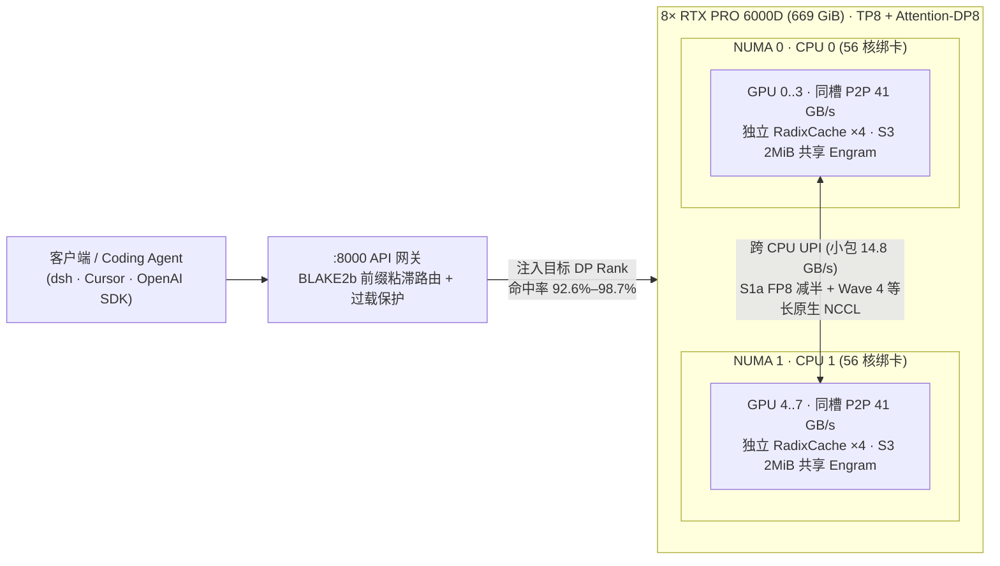

# xtier_86kd 核心架构、实现方法与关键算法伪代码

本文档面向社区公开 **`xtier_86kd`（Wave 4 生产默认栈）** 在 **8 × NVIDIA RTX PRO 6000D 84GB（Blackwell SM120，总显存 669 GB，无 NVSwitch / 无 PCIe Switch）** 上部署 **`DeepSeek-V4.1-Flash-1017` + `DSpark`** 的全栈工程思路、关键破案过程与核心算法伪代码。

> **开源边界说明**：本仓库公开全部实测报告、脱敏原始数据、统一评测脚本以及本篇架构原理与伪代码；底层 CUDA/Triton 内核、零侵入运行时钩子、官方 DeepInfer 逐字节对齐补丁与生产网关源码保留在私有研发仓库中，不对外开放源码。

---

## 一、系统总体架构与硬件约束

`tf500` 的物理拓扑决定了所有优化的出发点：**高显存带宽（8 卡合计 10.24 TB/s）+ 工作站 SM120 核心 + 双路跨 CPU UPI 窄总线（无 NVSwitch / 无 PCIe Switch）**。



### 为什么锁定 `TP8 + Attention-DP8`，而永久熔断 `EP8`？

1. **为什么不能用纯 TP8？**
   DeepSeek-V4.1 采用 MLA 压缩注意力，单共享 KV 头无法沿 TP 维度切分。纯 TP8 下 8 张卡被迫镜像存储同一份完整 KV，全局有效主 KV 池仅 `5.25M` token（连 32 路 32K 会话都装不下），且 64 并发下吞吐倒挂至 `699 tok/s`。
2. **为什么不能用 EP8（专家并行）？**
   在无 PCIe Switch 的双路主板拓扑下，跨 CPU 的 `EP8 AllToAll` 通信必须穿过窄 UPI 桥。我们在真机门禁实测单步通信耗时 **`833.7 ms`（EP8）vs `9.66 ms`（TP8）——慢 `86.3×`**，因此在无 Switch 机型上永久熔断 `EP8`，锁定 **MoE 走 TP8 + Attention 走 DP8**（而在自带双 8 卡 PCIe 5.0 Switch 托盘的 16 卡机型上再解锁满血 `DP8 + EP8`）。

---

## 二、支柱一：Attention DP8 + 混合 FP4 主 KV 池

将注意力层切为 `DP=8`，8 张卡各自持有独立 RadixCache 与独立请求队列；主层 KV 采用 4-bit 块量化，滑动窗口层（SWA）保持 FP8 精度并扩大尾部预算，搭配专为 DP8 实测校准的 `DSpark` 变长验证成本表。

```python
# 伪代码：Attention-DP8 + 混合精度 KV 池容量分配与验证预算
def configure_dp8_kv_pool(vram_per_gpu_gib=83.6, mem_fraction=0.85):
    # 1. 紧凑对齐权重后单卡固定占用（含 TP8 MoE + 注意力 + 词表）
    weights_gib = 52.39                   # pad(512 -> 128) 每卡净省 4.98 GiB
    runtime_workspace_gib = 3.20          # 捕获 CUDA Graph + 激活暂存
    kv_budget_per_rank = vram_per_gpu_gib * mem_fraction - weights_gib - runtime_workspace_gib

    # 2. 混合 KV 布局：主层 FP4（低字节、撑容量）+ SWA 滑窗层 FP8（保局部高精度）
    #    每个 DP Rank 独立建树，不与其他 Rank 镜像重复 -> 全局容量直接 ×8
    per_dp_main_kv_tokens = allocate_fp4_main_pool(kv_budget_per_rank, swa_tails=384)
    global_main_kv_tokens = per_dp_main_kv_tokens * 8   # 实测 13.54M × 8 = 108.29M tok

    # 3. 加载 Attention-DP8 专属 DSpark 变长验证成本表
    #    不同并发下的草稿步长与验证宽度按 DP8 实测延迟曲线查表，而非沿用纯 TP8 经验值
    sps_cost_table = load_dp8_measured_cost_table()
    return global_main_kv_tokens, sps_cost_table
```

- **实测收益**：全局主 KV 容量从 `5.25M` 暴涨 **`20.6×`** 至 **`108.29M` token**（比显存多 99G 的市面 96G×8 vLLM 方案反超 `6.0×`），顺利吞下 `512K×64`、`1M×32`、`1M×64` 三大爆池区且 0 OOM。

---

## 三、支柱二：官方 DeepInfer 精度对齐与 `FP32-mid` Split-K 读核

在追求极致吞吐的同时，我们对量化语义逐项对标官方 DeepInfer，并定位修复了底层 SM120 混合 KV Split-K 读核的隐蔽二次截断缺陷。

### 1. 量化语义对齐原则

| 对齐项 | 核心机制 | 验证标准 |
|---|---|---|
| **A1 / A2** | 对齐 SWA 最小尺度下限与主 KV FP4 精确倒数乘法编码 | 1,702 万个精确舍入中点全量对撞 0 字节差异 |
| **A3 / A7** | 对齐稀疏索引器单次量化路径 & 修正 MXFP8 块尺度 `1.75 × 2^k` 极值边界 | 消除极值处尺度意外翻倍漂移 |
| **A4 / A5 / A8** | 保留原生 FP32 归约，不做迁就低精度硬件的伪量化降级 | 精度高于或等于官方基线 |

### 2. `FP32-mid` Split-K 读核破案伪代码

常规 Split-K 注意力读核在单个 CTA 内虽用 `FP32` 做局部 softmax 累加，但在写回全局中间缓冲 `O_partial` 时提前截断为 `BF16`，导致合并阶段引入二次舍入误差；同时固定按上限分配 CTA 会产生大量无效空线程。

```cpp
// 伪代码：FP32-mid Split-K 注意力读核（消除中间 BF16 二次舍入 + 动态有效分块）
__global__ void splitk_stage1_fp32mid(
    const QTensor Q, const FP4KVPool KV,
    float* O_partial_fp32,   // 关键修复：中间部分和全程保留 FP32，禁止提前截断 BF16
    float* LSE_partial_fp32,
    int seq_len, int num_active_splits)
{
    int split_id = blockIdx.z;
    if (split_id >= num_active_splits) return;  // 仅按实际序列分块数发有效线程，消空转

    float acc_o[HEAD_DIM] = {0.0f};
    float m_i = -INFINITY, l_i = 0.0f;

    for (int kv_blk : range_of_split(split_id, seq_len)) {
        // 在寄存器内反量化 FP4 KV（使用与 A2 逐字节一致的精确倒数尺度）
        float k_reg[HEAD_DIM], v_reg[HEAD_DIM];
        dequant_fp4_exact_rcp(KV[kv_blk], k_reg, v_reg);

        // 在线 Safe-Softmax 全程 FP32 累加
        online_softmax_update_fp32(Q, k_reg, v_reg, acc_o, m_i, l_i);
    }

    // 直接写出 FP32 中间结果（不做 BF16 cast），供 Stage-2 精确合并后再转输出 dtype
    store_fp32(O_partial_fp32, split_id, acc_o);
    store_fp32(LSE_partial_fp32, split_id, m_i + logf(l_i));
}
```

- **实测收益**：相对常规 Split-K 截断路径，读回数值误差 **下降 29%** 且读核本身 **提速 +18%**；端到端 3 段代码 PPL = **`2.0736`**（偏差 `+0.279%`，远优于 `±0.5%` 红线），768 tok 贪婪解码 SHA-256 **100% 逐位一致**，累计 15,833 个 Decode 批次 **0 乱码**。

---

## 四、支柱三：SM120 原生算子、紧凑对齐与 10 形状 MXFP8 路由

RTX PRO 6000D 属于 Blackwell 工作站核心 **SM120**（不含数据中心 SM100 专属指令），直接照搬 B200 配置会触发指令报错或回退慢核。

1. **SM120 原生块缩放与 `pad(128)` 紧凑对齐**：主模型与草稿 MoE 统一启用 SM120 原生 `MXMMA e3m4` 块缩放指令（MoE 实测提速 `2.35×`）；针对 TP8 下路由专家维 `288` 无法整除的问题，将权重对齐填充从默认 `512` 压缩至 `128` 紧凑边界，**每卡直省 `4.98 GiB`（8 卡净赚 `39.84 GiB` 显存全转主 KV 池）**。
2. **真机扫描 10 形状逐比特零误差 MXFP8 静态路由表**：对模型高频出现的 10 种线性投影 `(N, K)` 形状在 SM120 真机上扫完候选内核，剔除所有存在微弱精度漂移的组合，仅将 **逐比特零误差且实测最快** 的核写入静态查找表，使慢回退核调用量骤降 **91.5%**。
3. **解码反量化清零（`wo_a`）与融合 `mhc.post`**：在 `T <= 48` 区间启用 FP8 分组 einsum 融合核，单步 Decode 反量化次数从 `200 → 0`；用融合核替代多步小算子拼接消除中间张量显存尖峰。

```python
# 伪代码：SM120 10 形状零误差 MXFP8 静态路由选择
ZERO_ERR_SM120_TABLE = {
    # 离线在 SM120 真机通过逐比特一致性校验 + 延迟基准后固化
    (N, K): best_verified_kernel_spec
    for (N, K) in CORE_10_PROJECTION_SHAPES
}

def sm120_linear_dispatch(x_act, w_mxfp8, scale_w):
    M, K = x_act.shape
    N = w_mxfp8.shape[0]
    spec = ZERO_ERR_SM120_TABLE.get((N, K))

    if spec is not None and M in spec.valid_m_range:
        # 命中真机验证的零误差快路径（优先原生 SM120 TMA Tile / MXFP8 GEMM）
        return launch_verified_mxfp8_gemm(x_act, w_mxfp8, scale_w, spec.tile_cfg)

    # 未覆盖形状安全回退到通用精确路径，保证绝对零精度漂移
    return fallback_exact_gemm(x_act, w_mxfp8, scale_w)
```

---

## 五、支柱四：跨槽 FP8 减半 (`S1a`)、共享大页 Engram (`S3`) 与 Wave 4 无损快路径

针对双路无 Switch 主板的跨 CPU 瓶颈与多卡锁步空转，我们实现了三项完全无损的系统级加速：

### 1. `S1a`：Prefill & Decode 双路跨槽激活 FP8 压缩

跨 CPU UPI 小包带宽仅 `14.8 GB/s`。我们将跨卡聚合的激活行由 `BF16` 实时量化打包为 **固定行宽 FP8 + 块尺度（单行字节直砍 `-48.4%`）** 再走 NCCL，并在 CUDA Graph 捕获前使用持久化静态地址缓冲池，彻底根治上游尾层图捕获时的悬垂指针 UAF 崩溃。

```python
# 伪代码：S1a CUDA Graph 内打包 FP8 跨卡聚合（跨 UPI 字节减半）
def dp_gather_packed_fp8_in_graph(local_bf16, persistent_pack_buf, persistent_recv_buf):
    # local_bf16: [M_local, H] (BF16, 2 bytes/elem)
    # 1. 量化并打包进持久化缓冲（固定设备地址，保证 CUDA Graph 重复回放零 UAF）
    #    每行布局 = [FP8 payload (H bytes) | block_scales (H/block * 4 bytes)] -> 总字节 -48.4%
    pack_bf16_to_fp8_with_scales(local_bf16, out=persistent_pack_buf)

    # 2. 跨 8 卡一次性 all_gather 紧凑字节流（跨双路 UPI 传输量接近减半）
    nccl_all_gather(persistent_recv_buf, persistent_pack_buf)

    # 3. 接收端按行解包还原为计算所需激活
    return unpack_fp8_with_scales_to_bf16(persistent_recv_buf)
```

### 2. `S3`：节点内 2 MiB 共享大页 Engram + 8 线程异步预取

188.8 GiB 的主机侧 Engram 表在传统 per-rank 模式下既消耗双倍内存带宽，又在每步触发跨卡 `all_to_all` 阻塞（实测 `1.86 ms/step`）。我们将其重构为 **每 NUMA 节点单副本 2 MiB 透明大页共享映射 + 本节点 8 线程 CPU 异步聚集 + 独立 `copy_stream` H2D 流水重叠**：

```python
# 伪代码：S3 per_node 共享大页 Engram + CPU 异步预取重叠
class SharedNodeEngramStaging:
    def __init__(self, numa_node_id, table_path):
        # 同 NUMA 节点的 4 张 GPU 进程共享同一份 2MiB THP 物理内存页（零冗余拷贝、不触发 Swap）
        self.shared_table = mmap_2mib_hugepage_readonly(table_path, numa_node=numa_node_id)
        self.gather_pool = ThreadPool(num_threads=8, affinity=numa_node_cores(numa_node_id))
        self.copy_stream = CudaStream(priority="non_blocking")

    def prefetch_async(self, token_ids_cpu, pinned_staging_buf):
        # 后台 8 线程并行从本节点共享大页收集嵌入行，与 GPU 前一层计算完全重叠
        future = self.gather_pool.submit(parallel_gather_rows, self.shared_table, token_ids_cpu, pinned_staging_buf)
        return future

    def wait_and_copy_to_gpu(self, future, pinned_staging_buf, gpu_dst, compute_stream):
        future.result()  # CPU 收集通常已在前层计算期间完成
        with stream_ctx(self.copy_stream):
            gpu_dst.copy_(pinned_staging_buf, non_blocking=True)
        compute_stream.wait_stream(self.copy_stream)
```

### 3. `Wave 4`：锁步空闲间隔清零 + 零拷贝等长原生 NCCL（含 `ncclGroupStart` 深度守卫）

Wave 3 剖析发现长文冷 Prefill 仍存在两大纯软件空耗：
- **块间空转**：为保护混跑 Decode 而设的 `prefill_decode_interval=20`，在全 8 卡都在纯 Prefill（无任何 Decode 请求）时仍会强制触发多余的空转同步 tick；
- **满块通信碎片**：8 卡 Prefill 长度完全相等时，变长 `reduce_scatterv` 仍拆成 8 次 `ncclReduce`。

同时我们在压测中捕获并根治了一个极其隐蔽的 **`ncclGroupStart` 延迟发射竞态**：当外层处于 `ncclGroupStart() ... ncclGroupEnd()` 作用域内时，NCCL 会把集体通信推迟到 `ncclGroupEnd()` 才真正入队；若在组内执行“补零到临时缓冲 → 调用 NCCL → 立即从临时缓冲拷回输出”的逻辑，后拷贝会在通信实际落盘前读走旧脏数据，偶发输出乱码。

```python
# 伪代码 A：Wave 4 锁步空闲间隔清零（无 Decode 时零空转，有 Decode 时完整保留保护）
def on_scheduler_step(dp_ranks_batch_tokens, interval_remaining):
    # 全 8 个 DP 进程基于同一份锁步聚合的全局 token 向量做完全一致的判定，绝不死锁
    if sum(dp_ranks_batch_tokens) == 0:
        # 全局空闲 tick：立即归零剩余计数，下一块 Prefill 零空转直入计算
        return 0
    # 只要任意 1 张卡存在 Decode，严格维持原有 interval=20 保护节奏
    return max(0, interval_remaining - 1)


# 伪代码 B：Wave 4 零拷贝等长原生 NCCL + ncclGroupStart 深度守卫
class GuardedPyNcclComm:
    def __init__(self):
        self.group_depth = 0

    def group_start(self):
        self.group_depth += 1
        raw_nccl_group_start()

    def group_end(self):
        try:
            raw_nccl_group_end()
        finally:
            self.group_depth = max(0, self.group_depth - 1)

    def fast_reduce_scatterv(self, output, input_tensor, split_sizes):
        all_equal = (len(set(split_sizes)) == 1)
        if all_equal and split_sizes[0] >= 64 and output.is_contiguous() and input_tensor.is_contiguous():
            # 纯零拷贝等长快路径：8 次 ncclReduce 合并为 1 次原生 ncclReduceScatter，零额外显存
            return raw_nccl_reduce_scatter(output, input_tensor)

        # 关键不变量：严禁在 group_depth > 0 时使用“临时缓冲 + 组内后拷贝”路径！
        # 因为 NCCL 在 group 内延迟发射，组内紧随的 copy_ 会在通信落盘前读出脏数据
        if self.group_depth > 0:
            return fallback_safe_scatterv(output, input_tensor, split_sizes)

        return fallback_safe_scatterv(output, input_tensor, split_sizes)
```

- **实测收益**：冷 Prefill 峰值由 `26.4K` 一路推升至 **`38,570 tok/s`**（`128K×64`，较单流上限高 `2.43×`），单流 `1M` 提速至 **`98.2 s`**，零额外显存占用，且 15,833 批连续压测 **0 乱码**。

---

## 六、支柱五：真实 Agent 生产护航（粘滞路由 + 保护分块 + NUMA 绑核）

### 1. `:8000` 前缀粘滞 DP 路由器

Attention DP8 下 8 张卡维护 8 棵独立 RadixCache。若客户端直连后端轮询派卡，第 2 轮换卡会导致前缀命中率跌至 **`24.1%`**、真实速度腰斩。我们在 `:8000` 网关层实现无状态前缀粘滞路由：

```python
# 伪代码：:8000 前缀粘滞 DP 路由器（跳过共享 system/tools + 防单卡热点过载降级）
def route_sticky_dp_rank(messages, inflight_per_rank, dp_size=8, max_inflight=8, max_skew=4):
    # 1. 构造会话前缀签名：跳过所有请求都相同的纯 system / developer / tools 头部
    #    防止团队共用同一 system prompt 时全部哈希撞到同一张卡造成单卡打爆
    prefix_key = blake2b_hash_user_assistant_prefix(
        messages, skip_shared_system_head=True
    )

    # 2. 查找历史热卡（LRU 映射表）或按一致性哈希确定首选卡
    preferred = session_lru_cache.get(prefix_key)
    if preferred is None:
        preferred = int.from_bytes(prefix_key[:4], "little") % dp_size

    # 3. 过载与倾斜保护：若首选卡拥堵或显著高于最空闲卡，自动降级分流到最空闲卡
    min_load = min(inflight_per_rank)
    if inflight_per_rank[preferred] < max_inflight and (inflight_per_rank[preferred] - min_load) <= max_skew:
        chosen = preferred
    else:
        chosen = argmin(inflight_per_rank)

    session_lru_cache[prefix_key] = chosen
    return chosen  # 通过 X-Data-Parallel-Rank 请求头透传给后端调度器
```

- **实测收益**：真实 `@deepseek-ai/dsh` 70 分钟压测中，前缀缓存命中率稳定 **`92.6% – 98.7%`**，单路 Decode 飙至 **`259.7 tok/s`**（1 并发）、**`100.9 tok/s`**（32 并发破百）、**`85.3 tok/s`**（64 并发）。

### 2. 混跑动态保护块（`Decode Protect 2048`）与双路 NUMA 绑核

```python
# 伪代码：混跑动态 Prefill 分块保护 + 双路 NUMA 拓扑隔离
def dynamic_prefill_chunk_size(any_rank_has_decode, active_prefill_reqs):
    if any_rank_has_decode:
        # 只要 8 张卡中任意 1 张正在执行在线 Decode，立刻将 Prefill 分块压至 2048，
        # 防止长文冷读霸占显存带宽拖垮在线用户的 TPOT 手感
        return 2048
    if active_prefill_reqs == 1:
        # 全局空闲时的单流冷读，放大续块至 16384 吃满张量核吞吐
        return 16384
    return 49152  # 多路纯并发冷读拉满 48K 吞吐块

# 双路 128 线程物理绑核：
# - NUMA 0（核 0..55）均分绑定给 GPU 0..3（每卡独占 14 核）
# - NUMA 1（核 64..119）均分绑定给 GPU 4..7（每卡独占 14 核）
# - 保留 16 核（每路各 8 核）隔离运行 HTTP 分词、:8000 粘滞网关与系统守护进程
```

---

## 七、延伸：从单机 8 卡到 16 卡 PD 物理分离

在单机 8 卡共池模式下，上述优化已将 32 人研发与 64 并发 Agent 的日常体验推到物理极限；唯一难以在单池内彻底兼得的场景是“32 人满载写代码时，突遇全新 `500K–1M` 冷文档强插”（`Decode Protect 2048` 会保住在途开发手感，但大文档首字被拉长至 90–120 秒）。

在配备 **双 8 卡 PCIe 5.0 Switch 托盘 + 8×400G GDR** 的 16 × 84GB 新机上，结合 `52.39 GiB/卡` 实测权重与 `384/128/64` 维度整除约束：
- **`4P + 12D`**：4 卡权重达 `75–79 GiB/卡` 必爆显存，且 128 草稿专家无法整除 12；
- **`6P + 10D`**：无法整除 384/64/128 且拆裂双 8 卡 Switch 托盘；
- **`8P + 8D`（黄金解）**：100% 对齐双 8 卡 Switch 物理边界（零跨 CPU 通信），8P 卸除解码路径叠加 Wave 4 专注大块冷读，8D 在 Switch 托盘上首次解锁满血 `DP8 + EP8` 纯解码图，彻底根治冷热混跑冲突。
